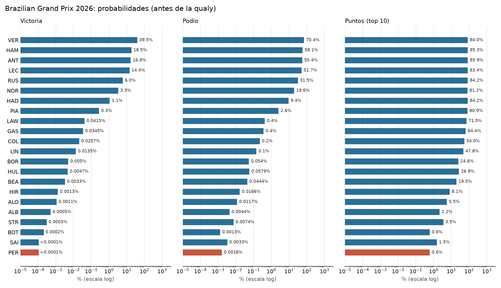

# Predicciones F1 2026

Pronósticos probabilísticos de Fórmula 1: probabilidad de victoria, podio y puntos de cada piloto, más una simulación del campeonato. Todas las métricas son walk-forward: cada carrera se predice solo con las carreras anteriores.

Inspirado en [mar-antaya/2025_f1_predictions](https://github.com/mar-antaya/2025_f1_predictions). Es una reescritura desde cero, sin código compartido.



## Último pronóstico: GP de Brasil, antes de la qualy

Aún no hay parrilla: se actualizará después de la qualy.

| Piloto | Equipo | Victoria | Podio |
|---|---|---:|---:|
| VER | red_bull | 39.5% | 70.4% |
| HAM | ferrari | 18.5% | 58.1% |
| ANT | mercedes | 16.8% | 55.4% |
| LEC | ferrari | 14.4% | 51.7% |
| RUS | mercedes | 6.0% | 31.5% |

## Resultado anterior: GP de la Ciudad de México

Ganó Verstappen desde el 5.º puesto de parrilla, con solo 7.1% de probabilidad en el pronóstico tras la qualy. Hamilton, el favorito (43.8%), fue segundo. Del podio previsto solo se cumplió Hamilton: Russell (80.1% de podio) acabó 6.º, mientras que Antonelli (32.0%) fue 3.º.

| Pos. | Piloto | Salida | Victoria prevista | Podio previsto |
|---:|---|---:|---:|---:|
| 1 | VER | 5 | 7.1% | 47.9% |
| 2 | HAM | 1 | 43.8% | 82.0% |
| 3 | ANT | 4 | 3.0% | 32.0% |
| 4 | LEC | 3 | 7.9% | 54.4% |
| 5 | NOR | 6 | 0.1% | 2.7% |
| 6 | RUS | 2 | 38.1% | 80.1% |

## Estado del modelo

- **Configuración:** los hiperparámetros están versionados en `src/f1pred/config.json`. Los de simulación y el blend se eligieron con `scripts/tune.py` usando solo 2023-2024.
- **Blend con la parrilla:** existe (`blend_alpha`), pero el ajuste ciego eligió `1.0`, así que está apagado. Con qualy, `f1pred predict` aplica el valor de `blend_alpha`; sin qualy nunca se aplica, porque la parrilla no se conoce.
- **Campeonato:** incluye incidentes por carrera y problemas estructurales por coche. Esos parámetros son priores a criterio, no ajustados a datos.

## Backtest

Tabla del periodo 2025-2026 (43 carreras, tras la qualy). Esas carreras no se usaron en el ajuste de la configuración 2.2.0, pero sí se vieron al diseñar el modelo y al evaluar versiones anteriores, así que no son un test totalmente ciego. México 2026 es la excepción: se corrió después de fijar la configuración.

| Método | Log-loss | Brier | Ganador | Spearman |
|---|---:|---:|---:|---:|
| **Modelo con qualy** | **0.965** | **0.487** | 60.5% | **0.673** |
| Solo parrilla | 1.229 | 0.541 | **67.4%** | 0.656 |
| Modelo sin qualy | 1.572 | 0.741 | 39.5% | 0.593 |
| Solo forma del piloto | 1.937 | 0.837 | 25.6% | 0.572 |

En log-loss y Brier, menor es mejor. Con bootstrap pareado al 90%, el modelo con qualy supera a la parrilla en log-loss (diferencia -0.264, de -0.438 a -0.098). En ganadores y Brier la diferencia no es concluyente. El detalle está en `results/backtest*.csv`.

## Campeonato

**Antonelli ya es campeón matemático:** tras 19 de 23 carreras tiene 380 puntos, 119 más que Verstappen (261), y solo quedan 100 en juego (4 carreras, sin sprints). Les siguen Hamilton (259), Russell (250) y Leclerc (245).

`f1pred championship` escribe la probabilidad de título en `results/2026_championship.csv`. `title_lo` y `title_hi` miden el error de muestreo Monte Carlo, no la incertidumbre del modelo.

## Variables

- **Forma:** piloto y equipo a corto y largo plazo, comparación con el compañero y posiciones ganadas.
- **Qualy:** parrilla, diferencia con la pole, forma en qualy y penalizaciones.
- **Circuito:** historial de piloto y equipo, adelantamientos, abandonos, paradas, altitud, tipo callejero y tasa de safety car.
- **Clima:** lluvia, temperatura y viento con Open-Meteo (archivo, pronóstico o normales climáticas), más rendimiento histórico en lluvia.
- **Fiabilidad y pits:** tasas de abandono, tiempo de pits, dispersión y longitud de stint por equipo.

La simulación añade ruido compartido entre compañeros, caos de carrera modulado por la tasa de SC/VSC del circuito, y más incertidumbre con lluvia. El campeonato incluye deriva de ritmo, sprints, incidentes correlacionados, problemas estructurales poco frecuentes y desempate por victorias.

Sin fuga de datos: un test modifica el resultado de una carrera y comprueba que sus variables previas no cambian. El reglamento de 2022 y 2026 reinicia la forma de los equipos.

## Uso

```bash
uv venv --python 3.13 && uv pip install -e ".[dev]"
.venv/bin/f1pred predict
.venv/bin/f1pred predict --round 20
.venv/bin/f1pred predict --grid "VER=5,ANT=4,LAW=9,LIN=8"  # sanciones de parrilla
.venv/bin/f1pred championship
.venv/bin/f1pred backtest
.venv/bin/python -m pytest
```

No necesita API keys. Los datos vienen de [Jolpica](https://github.com/jolpica/jolpica-f1), [Open-Meteo](https://open-meteo.com) y, para SC y ritmo por vuelta, [OpenF1](https://openf1.org).

## Reproducibilidad

- `uv.lock` fija las dependencias.
- `scripts/snapshot.py` genera `data_cache_hashes.json` con el SHA-256 de cada archivo de `data/`. Registra el estado local; la CI no lo compara.
- `scripts/tune.py` rehace el ajuste ciego de 2023-2024 (opción `--write` para volcar a `config.json`).
- `.github/workflows/ci.yml` corre `pytest` y `backtest`.

## Limitaciones

- El ritmo por vuelta y la degradación de neumático de OpenF1 2026 **existen** (`data.fetch_openf1_laps`) pero aún no se cablean como features: falta el mapeo estable circuito/piloto con lagging sin fuga para toda la serie. Es el siguiente paso natural.
- La tasa de SC/VSC por circuito es un prior histórico; `data.refresh_sc_rates` la puede refinar con OpenF1 (mejor esfuerzo).
- El entrenamiento usa el clima real, mientras que una carrera futura usa el pronóstico o la normal climática.
- Los parámetros de la cola del campeonato (incidentes, problema estructural) son priores razonables, no ajustados a datos.

## Licencia

MIT
